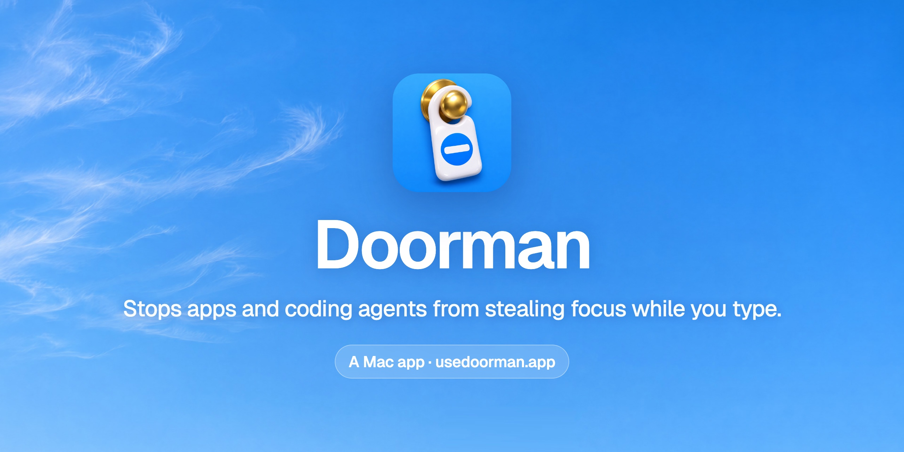

# Doorman

A Mac app that stops other apps and coding agents from stealing focus while you type.

**[usedoorman.app](https://usedoorman.app)** · macOS 15 or later · free during the beta

This repo is where Doorman's community lives: bug reports, feature requests, questions and release notes. The app's source code isn't public.

## What it does

- If something jumps in front while you're typing, Doorman puts your window back.
- Windows that coding agents like Claude Code and Codex open wait off to the side until you want them.
- You can see when an agent is using your keyboard or mouse, and ⌃⌥⌘⎋ pauses every agent.
- Agents can ask to come forward with `doorman focus`, for things like a sign-in window.
- It only listens to input, so it can't block or delay a keystroke. Nothing leaves your Mac.

## Get it

Download it from [usedoorman.app](https://usedoorman.app). It isn't notarized yet, so the one line terminal install on the site is the easiest way in.

## Say something

- **Something broke:** [open a bug report](https://github.com/usedoorman/doorman/issues/new?template=bug_report.yml)
- **You want something:** [request a feature](https://github.com/usedoorman/doorman/issues/new?template=feature_request.yml) or post it in [Ideas](https://github.com/usedoorman/doorman/discussions/categories/ideas)
- **Questions, setups, which apps your agents keep opening:** [Discussions](https://github.com/usedoorman/doorman/discussions)

I read everything. You can also find me at [@OgnjenAdzic](https://x.com/OgnjenAdzic) on X.
